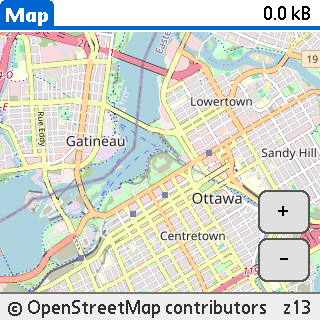
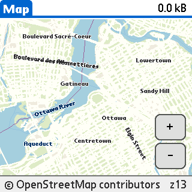
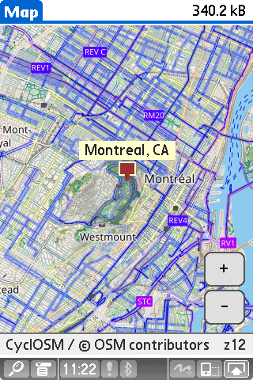
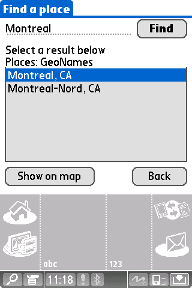

# Map for Palm OS 5

Map is an OpenStreetMap viewer for Palm OS 5 on ARM handhelds. It uses
Palm's native forms through PACE. PNG decoding, vector rendering and
coordinate projection run in an ARMv4T ARMlet. Fixed Graffiti areas and
Palm OS dynamic input areas both work.

The [latest release](https://github.com/palmsnipe/palm-map/releases/latest)
includes `Map.prc` and `PalmTLSArm-Modern.prc`. Install both with HotSync,
from a card, or in CloudpilotEmu. For source builds,
build Map and fetch PalmTLS as described below. Open **Map**. Drag with the stylus,
pan with the directional buttons, or use
**+** and **−** in the lower right of the map to change zoom. **Map → Find**
searches over 34,000 cities offline. Try `Montreal` or `45.5017, -73.5673`,
select a result, and tap **Show on map**. Exact city names appear first.
Use **Map → Go to pin** to return to the marker at the current zoom.
**Map → Clear pin** removes the marker in place.
Open the **Layers** menu and tap a layer to switch.

| Streets on the Tungsten E2 | Shortbread on the Tungsten E2 |
| --- | --- |
|  |  |

| Cycle Map on the Palm TX | Find on the Palm TX |
| --- | --- |
|  |  |

Map views © [OpenStreetMap contributors](https://www.openstreetmap.org/copyright).
Cycle Map rendering by [CyclOSM](https://www.cyclosm.org/), hosted by OpenStreetMap France.
The [launcher screenshot](screenshots/launcher-e2.png) shows the Map icon.

- **Streets**: the standard OpenStreetMap raster style, zoom 0–19.
- **Night**: a darker rendering of the same OpenStreetMap tiles. Shares the
  tile cache with Streets.
- **Cycle Map**: CyclOSM raster tiles with cycling routes and infrastructure,
  served over HTTPS by OpenStreetMap France. See the [CyclOSM map](https://www.cyclosm.org/)
  and the [OpenStreetMap France usage policy](https://www.openstreetmap.fr/usage/).
  This public endpoint is for free, nonprofit apps with moderate traffic.
- **Overview**: a built-in Natural Earth map, zoom 0–3, usable without a connection.
- **Custom**: set a tile template under **Map → Custom tile layer**. Use an
  authorized provider or your own server, with an HTTPS URL such as
  `https://maps.example.org/{z}/{x}/{y}.png`, non-interlaced 256 × 256 PNG tiles,
  and a domain certificate trusted by the bundled GlobalSign/ISRG roots.
  Enter the provider's on-map credit in **Map attribution** so it fits on one line. Clear the template
  to disable the layer.
- **Shortbread**: live OpenStreetMap vector tiles with a compact style for
  land, water, borders, streets and building footprints. City names appear
  from zoom 4, water names from zoom 5, and street names from zoom 10 where
  supplied. Named landmarks such as towers, museums, and
  historic sites appear from zoom 14. Labels use Palm font glyphs at native
  pixel size. Street names follow their road segment, and landmark names
  stay horizontal. Labels avoid other labels, the search pin, and the zoom
  buttons. At display zooms 15–19, the app reuses a level 14 source tile and
  its label index.
  See the [Shortbread schema](https://shortbread-tiles.org/schema/1.0/)
  and the [OSM vector tile policy](https://operations.osmfoundation.org/policies/vector/).

Open **Layers → Shortbread settings** to show or hide roads, buildings,
water, land cover, city and water names, street names, and landmarks.
Provincial and national borders have separate switches. Turn off **Angle
streets** to draw road labels horizontally, or enable high contrast for more
distinct roads and features. **Apply** saves your choices.
**Defaults** restores the original selections in the form.

Map opens on Streets and restores the saved viewport and marker. The tile cache is bounded
to about 3 MiB and uses server expiry and validators. Tile response buffers grow as
needed up to 1 MiB. Shortbread tiles can expand to 2 MiB during decoding.
Map only requests tiles visible after a pan or zoom.
See the [standard tile policy](https://operations.osmfoundation.org/policies/tiles/).
To retry after connecting, tap the footer or use **Map → Retry tiles**.

The top-right counter shows tile data downloaded in the current launch in
decimal kilobytes. It counts compressed tiles as received and stays unchanged
when you use cached tiles. **Map → Offline mode** stops new tile downloads
until you select **Online**. Cached tiles and the bundled Overview remain
available, and the counter shows **Off** while offline mode is active.
For raster layers, Map can enlarge tiles cached up to two zoom levels
out. These views are marked **Cached preview**.

## Enable HTTPS

Use the published ARM Modern profile, `PalmTLSArm-Modern.prc`. This build
was tested with PalmTLS 0.1.12. PalmTLS profiles share a database name, so
install one profile at a time. Set the Palm's clock and configure an IPv4
connection. [Download PalmTLS ARM Modern](https://github.com/palmsnipe/palm-tls/releases/download/v0.1.12/PalmTLSArm-Modern.prc)

Map defaults to **TLS 1.3** for the built-in layers. The published TLS 1.2
engine lacks the certificate support those layers need. You can select
**TLS 1.2** in **Map → HTTPS mode** for a compatible custom endpoint.
An upgrade from older Map versions starts in TLS 1.3.

Map verifies HTTPS certificates and hostnames. PalmTLS supplies these
connections with legacy system randomness, which requires no seed setup.
Map is intended for public map tiles.

City and coordinate searches run locally. Online map requests send the
visible tile coordinates and Map's user agent to the selected tile provider.
The provider also sees the connection's IP address.

## Build

With the [Palm Toolchain](https://github.com/palmsnipe/palm-toolchain) and a
user-supplied SDK 5r4 installed, plus Node, Python 3, and host zlib headers:

```sh
make PALM_TOOLCHAIN_ROOT=../palm-toolchain test
```

This builds `build/Map.prc`, checks the package and runs host tests for indexed
PNG, corrupt tiles, the bundled atlas, Mercator projection, gzip, vector overzoom, indexed labels and rotated text. The checked-in
map assets are ready to build. To regenerate them, download the sources from
[THIRD_PARTY.md](THIRD_PARTY.md), install ImageMagick 7, and run
`python3 tools/assets.py data /path/to/countries.geojson /path/to/cities15000.zip`.

Run `tools/fetch-palmtls.sh` to download the published PalmTLS ARM Modern
PRC into `build/` and check its SHA-256 against the release digest.

Map's source and original launcher artwork are GPL-3.0-or-later. Release
downloads include a corresponding source archive for Map and the PalmTLS
library. See [THIRD_PARTY.md](THIRD_PARTY.md) for data and dependency attribution.

## GitHub releases

The [Build Map workflow](.github/workflows/build-release.yml) builds and tests
Map on pushes to `main` and on manual runs. Pushing a tag such as `v0.2.8`
also creates a draft GitHub release. Match the tag to the version in
`resources/app.rcp` and add release notes under `docs/releases/` before tagging.

The build uses the private Palm Toolchain SDK container. Maintainers configure
a read-only registry credential as the `PALM_TOOLCHAIN_REGISTRY_TOKEN`
Actions secret for the trusted build workflow.

To create the same download set locally, run `make test`,
`tools/fetch-palmtls.sh`, and `python3 tools/package-release.py` from a clean
commit. The PRCs, install ZIP, source archive, and checksums appear in
`build/release/`.

## Verification

`make test` passed. In CloudpilotEmu, Map was installed and exercised on a
Tungsten E2 (Palm OS 5.4.7, fixed input area) and a Palm TX (5.4.9, DIA).
Checks covered live OpenStreetMap HTTPS rendering, switching to Night,
pan and zoom, offline city and coordinate lookup, and resizing with the
TX input area open and closed. An HTTPS fixture served 99,790-byte tiles
with an ETag; after relaunch it received conditional GETs and returned
304 while Map displayed the tiles from disk. Physical hardware was not tested.

Map 0.1.1's TLS 1.2 compatibility mode was also verified on the Tungsten E2
with no provisioned seed: live OpenStreetMap tiles loaded at zoom levels
3 and 4, and the mode persisted across relaunch.

For Map 0.1.2, both emulated devices loaded OpenStreetMap tiles using the
default TLS 1.2 setting. The E2 check covered the Find and Layers menu items
and an update from 0.1.1 with a saved layer, zoom level, and marker. The TX
check covered both zoom controls with the input area closed and checked their
position with the input area open.

Map 0.1.6 loaded live Shortbread tiles over TLS 1.2 on CloudpilotEmu's
Tungsten E2 at the default 100 MIPS. At Parliament Hill, the ARMlet took an
average of 200 ms per tile at zoom 14 (four tiles, 260 ms maximum) and
80 ms per tile at zoom 19 (four tiles, 80 ms maximum). The zoom 19 pass
reused a decompressed source tile in RAM. These timings cover drawing the
256 × 256 tiles in the ARMlet. The benchmark measures decompression separately
and excludes download, bitmap allocation and screen updates. To reproduce the
timing overlay, build with `make BUILD_DIR="$PWD/build/vector-bench" VECTOR_BENCH=1`.

Map 0.1.7 was tested at the same Parliament Hill coordinates on the
emulated Tungsten E2 at 100 MIPS. Times are averages over four 256 × 256
tiles at each zoom. Label selection and painting are measured once per
viewport redraw, separately from the ARMlet.

| Zoom | Geometry in the ARMlet | Label extraction in the ARMlet | Viewport labels |
| --- | ---: | ---: | ---: |
| 14 | 202 ms/tile | 52 ms/tile | 20 ms, 8 labels |
| 19 | 87 ms/tile | 42 ms/tile | 0 ms, no anchors in the centered view |

Panning toward Peace Tower at zoom 19 rendered its name and point marker.
Palm OS reports timings in 10 ms ticks. Network transfer and screen
blitting are outside these timings.

Map 0.1.8 repeated the test at Parliament Hill on the emulated Tungsten E2
at 100 MIPS. Four visible tiles were timed at each zoom. Times use Palm OS
ticks at 100 Hz.

| Zoom | Geometry | Label extraction | Final viewport label pass |
| --- | ---: | ---: | ---: |
| 14 | 165 ms/tile | 35 ms/tile | 20 ms for eight labels |
| 19 | 80 ms/tile | Under 10 ms/tile | 10 ms for one label after panning to Peace Tower |

The first overzoom built the label index for the Parliament Hill source tile
in 80 ms. The zoom 19 tile measurement reused that index. Tile download,
inflation, and screen bitmap blitting were measured separately or outside
these figures.

Map 0.2.1 was checked on the emulated Tungsten E2 at 100 MIPS. Four
CyclOSM tiles at zoom 14 averaged 52 ms each to decode. The Shortbread
geometry pass at Parliament Hill averaged 10 ms per tile at zoom 19
with the source tile and its path index already in memory. The download
counter increased on live requests and held steady when revisiting cached
tiles and overzooming the same vector source.

Map 0.2.5 was benchmarked at Parliament Hill on the emulated Tungsten E2
at 100 MIPS with all four geography options on. Processing four display
tiles took about 1,040 ms at zoom 14 and 40 ms at zoom 19 with the decoded
source and indexes in RAM. At zoom 19, decompressing and indexing the
cached source added about 150 ms. The timings include geometry, label
extraction, and the final viewport label pass. Network wait and terrain
bitmap blitting are outside these timings. The overlays use the same tile
payload as the rest of Shortbread.
